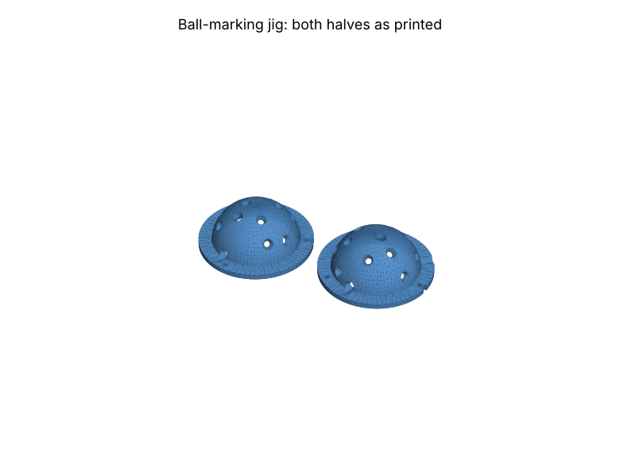
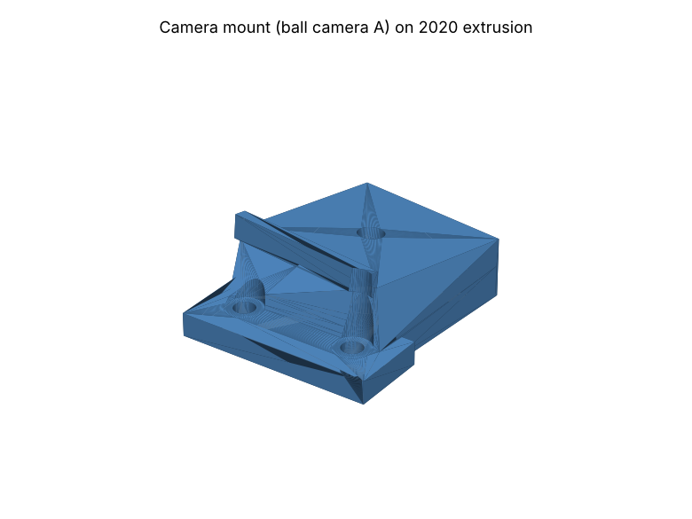

# 3D printing (Bambu A1 Mini)

Ready-to-print files are in [`cad/stl/`](../cad/stl). They are generated from the OpenSCAD
sources in `cad/` by `python tools/export_cad.py`, using the same ball pattern, rig geometry and
club-marker layout that the solver assumes. Don't edit the STLs by hand: change the `.scad`
parameters or the Python geometry, then re-export. (Claude Code can do this for you.)

Filament: **PETG** for everything. It's stiffer under warmth than PLA and doesn't need an
enclosure like ASA. Defaults are fine unless noted.

| File | Qty | Stage | Settings |
|---|---|---|---|
| `ball_jig_both_halves.stl` | 1 | now | 0.12-0.16 mm layers, 3 walls, flange down, no supports |
| `camera_mount_ballA.stl`, `camera_mount_ballB.stl` | 1 each | 1 | 0.2 mm, 4 walls, 40% infill, no supports |
| `camera_mount_clubA.stl`, `camera_mount_clubB.stl` | 1 each | 2 | as above |
| `../club_markers.svg` | sheet | 1 | paper, not 3D: print at 100% on matte white sticker paper |

The enclosure and battery box come later, once the boards and pack are in hand to measure.

## Ball-marking jig

Two half-shells with a countersunk hole at every pattern dot (30 dots, 3.5 mm).

1. **Test the fit first.** The ball should drop in snugly and not turn once the halves are closed.
   If it's loose or won't close, change `clearance` in `cad/ball_jig.scad` (default 0.25 mm,
   radial) and re-export.
2. **Pins:** cut three ~6 mm pieces of 1.75 mm filament. The three pin holes are unevenly
   spaced, so the halves only line up one way. The notches on the flange edges should line up
   too. If PETG prints the holes tight, open them with a 2 mm drill bit by hand.
3. Close the jig around a clean ball. Turn the ball so its logo sits under solid shell, not a
   hole, before closing.
4. Mark through every hole with a **Sakura Pigma Micron 05 (or 08)**: a firm, circular motion
   fills the 3.5 mm hole. Do all 30 dots (15 per half) without opening the jig.
5. Let it dry for a minute before opening.
6. **IR check (once you have the camera and LEDs):** the dots must look black under 850 nm. If
   they fade, switch pens.

Every ball must use **this exact pattern**. `src/launchmonitor/data/ball_pattern.json` is now
fixed, so don't regenerate it.

## Camera mounts

* Bolts to the top of a 2020 extrusion with 2x M5x10 screws and 2020 T-nuts.
* The camera sits on the tilted platform with a 1/4"-20 x 5/8" screw from below into the
  camera's tripod adapter. Push the camera back against the angled fence before tightening.
* Pre-angled from the rig geometry:

  | Mount | Yaw (toe-in) | Pitch |
  |---|---|---|
  | ballA / ballB | -8.7° / +8.7° | -6.1° (down) |
  | clubA / clubB | -10.0° / +10.0° | -15.5° (down) |

* Space the two cameras of a pair **200 mm apart** (lens centre to lens centre). Camera A is
  the left one when you stand behind the unit facing the ball.
* Stereo calibration measures the exact pose, so a degree or so of error is fine. Once
  calibrated, the cameras must not move: add a drop of medium thread-locker, or a dab of hot
  glue between camera and fence.
* UNVERIFIED: check the tripod adapter's footprint and thread depth against a real camera
  before printing both.

## Club markers

`cad/club_markers.svg` has 12 sets of 4 dots. Print at 100% and check the 50 mm bar. Cut out
one set and stick it on the face **near the toe**, arrow toward the toe, with the dot rows
parallel to the grooves. Keep it clear of the ball's contact patch, or the sticker wears fast.
